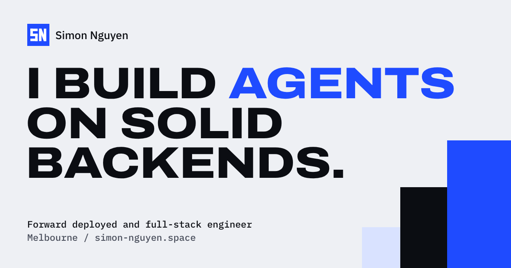

<div align="center">


# Simon Nguyen, portfolio

**Forward deployed and full-stack engineer in Melbourne. I build agents on solid backends.**

[](https://simon-nguyen.space)
[](https://nextjs.org/)
[](https://react.dev/)
[](https://gsap.com/)
[](https://www.typescriptlang.org/)
[](LICENSE)

[Features](#features) • [Getting started](#getting-started) • [Configuration](#configuration) • [Project structure](#project-structure) • [Deployment](#deployment)



</div>

A multi-page portfolio with a poster-weight, square-cornered design and one cobalt accent. Real product screenshots sit on a desk you can drag around, work is told through live illustrations, and an **Ask my CV** palette answers questions with retrieval over the CV. A hidden wizard mode brings back the original site's 3D wizard and anime music player.

## Features

- **Five routes**: home, `/work` with filters, the `/work/syncnapse` case study, `/about` and `/contact`. The old `/projects` URL redirects to `/work`.
- **Light and dark themes** that follow the system until you pick one. The choice is saved and applied before the first paint, so there is no flash.
- **Scroll motion** with GSAP (ScrollTrigger, SplitText, Draggable, Inertia, Flip) and Lenis smooth scrolling. Every scroll-in plays in reverse on the way back up, and pages change behind a stair-column wipe.
- **Ask my CV**: a `Cmd/Ctrl + K` palette, plus an inline panel on the contact page. Answers stream from a RAG endpoint over the CV (OpenRouter, Supabase pgvector, LangChain.js), with prewritten fallbacks for the suggested questions.
- **Live GitHub feed** of recently updated repositories, cached in Upstash Redis.
- **Contact form** through EmailJS, with validation messages that say how to fix each field.
- **Wizard mode** 🧙: type `accio` anywhere (or use the Konami code) for the night forest palette, fireflies, the 3D wizard and the music player. It stays on across pages until you leave it.
- **Metadata**: SN monogram favicon and Apple icon, Open Graph and Twitter cards, per-page titles, `sitemap.xml` and `robots.txt`.
- **Accessible by default**: keyboard-friendly menu and palette with focus trapping, and all motion turns off under `prefers-reduced-motion`.

## Getting started

### Prerequisites

- [Bun](https://bun.sh/) 1.1+ (recommended) or Node.js 20.9+
- Accounts for the services in [Configuration](#configuration)

### Run locally

```bash
git clone https://github.com/cobeo2004/portfolio-nextjs.git
cd portfolio-nextjs
bun install
cp .env.example .env.local   # then fill in the values
bun dev
```

Open [http://localhost:3000](http://localhost:3000).

> [!IMPORTANT]
> Environment variables are validated at build and start time by `src/lib/env.ts`, so every key in `.env.example` needs a value, even for services you don't use locally.

### Scripts

| Command | What it does |
| --- | --- |
| `bun dev` | Start the dev server on port 3000 |
| `bun run build` | Production build (includes type checking) |
| `bun start` | Serve the production build |

## Configuration

| Service | Variables | Used for |
| --- | --- | --- |
| [OpenRouter](https://openrouter.ai) | `OPENROUTER_API_KEY`, `OPENROUTER_MODEL` | The model that answers CV questions |
| [OpenAI embeddings](https://platform.openai.com) | `OPENAI_API_KEY`, `EMBEDDING_MODEL` | Embedding the CV and each question |
| [Supabase](https://supabase.com) | `NEXT_PUBLIC_SUPABASE_URL`, `NEXT_PUBLIC_SUPABASE_ANON_KEY`, `SUPABASE_SERVICE_ROLE_KEY` | pgvector store for CV chunks |
| [Upstash Redis](https://upstash.com) | `UPSTASH_REDIS_REST_URL`, `UPSTASH_REDIS_REST_TOKEN` | Rate limits and the GitHub cache |
| GitHub | `GITHUB_TOKEN`, `GITHUB_USERNAME` | The live repository feed |
| [EmailJS](https://www.emailjs.com) | `NEXT_PUBLIC_SERVICE_ID`, `NEXT_PUBLIC_TEMPLATE_ID`, `NEXT_PUBLIC_KEY` | The contact form |

### How Ask my CV works

1. `public/assets/pdf/CV.pdf` is split, embedded and stored in Supabase. This runs automatically on the first question, or by hand with `POST /api/ingest`.
2. Each question is embedded, the closest CV chunks are retrieved, and the model answers from them.
3. The answer streams back as plain text. Requests are rate limited to 10 per 15 minutes per IP.

| Endpoint | Purpose |
| --- | --- |
| `POST /api/chat` | Ask a question. Body: `{ "messages": [{ "id", "role", "content", "createdAt" }] }` |
| `POST /api/ingest` | Ingest the CV |
| `GET /api/ingest` | Check ingestion status |
| `DELETE /api/ingest` | Clear ingested documents |
| `GET /api/repo` | Cached GitHub repositories |

> [!TIP]
> To change what the site says, edit `src/lib/data.ts`. Projects, experience, awards, skills, suggested CV questions, navigation and the music list all live there, typed in `src/types/index.d.ts`.

### Design tokens and motion

- Colours are CSS variables in `src/app/globals.css`, defined for the light, dark and wizard themes, and exposed to Tailwind as `paper`, `surface`, `ink`, `line` and `cobalt` (for example `bg-cobalt`, `text-ink-2`).
- Shared scroll motion lives in `src/components/motion/PageMotion.tsx` and is driven by data attributes: `data-split`, `data-rise`, `data-row`, `data-reveal`, `data-count`, `data-par`, `data-light` and `data-stack`. Add the attribute to the markup instead of writing a new effect.

## Project structure

```text
src/
├── app/                 # Routes, layout, metadata images, sitemap, robots, API routes
│   └── fonts/           # Archivo (width axis), IBM Plex Sans and Mono, self-hosted
├── components/
│   ├── navigation/      # Header, menu sheet, transition links
│   ├── home/ work/ about/ case-study/ contact/   # Page sections
│   ├── widgets/         # Animated illustrations (call, docs, hub, coalescer)
│   ├── chatbot/         # Ask my CV palette and inline panel
│   ├── motion/          # Shared scroll motion
│   ├── wizard/ models/ Sounds/   # Wizard mode, 3D wizard, music player
│   └── footer/ layout/ icons/
├── hooks/               # useSite, useAskCV, useFormEmailSubmit, useGetProjects, useSounds
├── lib/                 # Content, GSAP setup, theme store, env, RAG and rate-limit helpers
├── providers/           # SiteProvider (theme, overlays, page transitions), QueryProvider
└── types/
```

## Deployment

The site is a standard Next.js app with `output: "standalone"`.

- **Vercel**: import the repository and add the environment variables. Vercel Analytics is already wired in.
- **Docker**: `docker build -t portfolio .` then `docker run -p 3000:3000 --env-file .env.local portfolio`. `NEXT_PUBLIC_*` values are inlined into the client bundle, so they must be present in `.env.local` before you build (it is copied into the image's build stage).

> [!NOTE]
> The 3D wizard loads its lighting preset and Draco decoder from public CDNs. If they are unreachable, wizard mode still works and the model is simply left out.

## Credits

The original site started from the [CodeBucks portfolio tutorial](https://www.youtube.com/watch?v=T5t46vuW8fo); the 3D wizard and music player come from that version. The redesign takes cues from Simon's own design work on Lead the Way, TrustLane and Lynn Le's portfolio.
